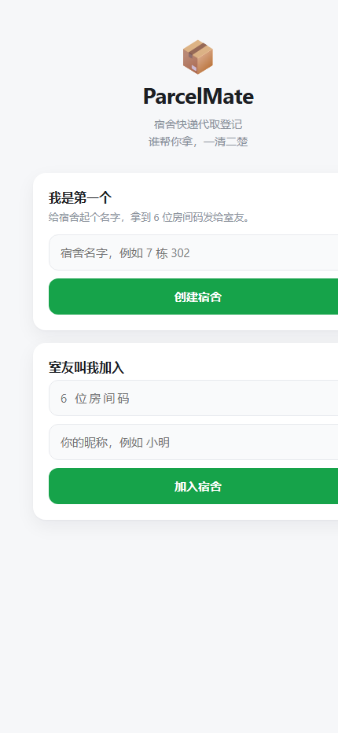
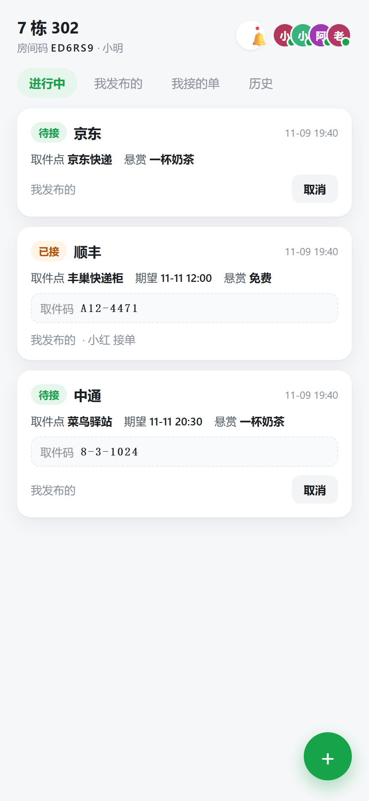
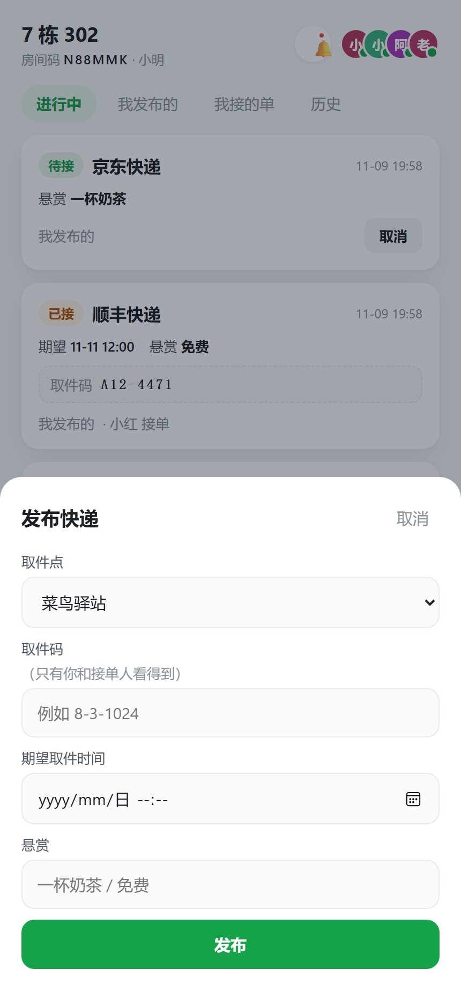

# 求你了 · 宿舍快递代取登记（ParcelMate）

> 宿舍群里那句「谁帮我取一下快递」，从满屏聊天记录变成一张能追踪状态的小卡片。

    

**在线演示**：<http://8.137.39.80:8080> —— 手机或电脑浏览器直接打开，不用装任何东西（阿里云 ECS 上跑的就是这个仓库的 jar）

## 这是什么

宿舍里最常见的两句话：**「谁帮我取个快递」** 和 **「收到，谢谢」**。
问题是这两句发出去之后，谁接了、取到没有、送没送到，全靠人脑记和聊天记录翻。

ParcelMate 把这个流程做成**一张卡片带状态**：

```
发布  →  待接  →  已接  →  已取  →  已送达
                      ↘ 已取消 / 异常（丢件、退回）
```

- 一个宿舍一个**房间码**，室友输入码 + 昵称就能进，不需要注册账号
- 发布时填：**取件点**（菜鸟 / 京东 / 多多 / 兔喜 / 顺丰 / 邮政）/ **取件码** / 期望时间 / 悬赏（"一杯奶茶"）
- 取件码只有**发布者**和**接单人**看得到，其他人看到的是隐藏状态
- 谁接的单、哪一步超时了，状态都标得清清楚楚

## 截图

| 加入宿舍 | 快递看板（手机） | 发布快递 |
| --- | --- | --- |
|  |  |  |

> 上面第二张是线上实例的真实截图：阿里云 Ubuntu 24.04 + systemd 跑同一个 jar，
> 手机浏览器直接打开，不是本地 mock。

## 在线地址

<http://8.137.39.80:8080>（阿里云 ECS 试用实例，systemd 托管；演示房间码见启动后 `seed_demo.py` 的输出）

## 功能范围（一期）

| 模块 | 内容 | 状态 |
| --- | --- | --- |
| M1 宿舍与成员 | 建房拿 6 位房间码、凭码加入、成员在线状态 | ✅ 完成 |
| M2 快递登记 | 发布快递、进行中列表、历史列表 | ✅ 完成 |
| M3 接单流转 | 接单 / 已取 / 已送达 / 取消，**版本号乐观锁防重复接单** | ✅ 完成 |
| M4 我的 | 我发布的 / 我接的 / 站内红点 | ✅ 完成（周统计属 W3） |

明确**不做**的：微信/QQ 推送（做站内红点）、地图导航、在线支付、原生 App。
理由写在 [docs/设计取舍.md](docs/设计取舍.md)：一期目标是宿舍 6 个人真能用起来，不是做一个"功能很全但没人用"的系统。

## 技术栈

| 层 | 选型 | 为什么 |
| --- | --- | --- |
| 后端 | Java 21 + Spring Boot 3.5 | 求职方向就是 Java 后端，框架必须会用 |
| 数据访问 | Spring JDBC (`JdbcTemplate`) + 手写 SQL | 先把 SQL 写熟，再谈 ORM |
| 数据库 | SQLite（单文件） | 宿舍 6 人量级，零安装、零运维；需要时再迁 MySQL |
| 前端 | 原生 HTML/CSS/JS | 不引入构建链，一个人维护得动 |
| 部署 | 阿里云 ECS（Ubuntu 24.04）+ systemd 托管 jar | 目标：**能在手机上直接打开**；systemd 开机自启，崩溃自动重启 |

## 关键设计：版本号乐观锁

两个人同时点"接单"，怎么保证只有一个人成功？

```sql
UPDATE parcel
   SET status = 'TAKEN', taker_id = ?, version = version + 1
 WHERE id = ? AND status = 'OPEN' AND version = ?
```

`WHERE` 里的 `status` 和 `version` 是两个门闩：别人已经接走（status 变了）或者你手上是旧版本（version 对不上），这条 SQL 就影响 0 行 —— 前端提示"手慢了"。
**永远不要**先 `SELECT` 查状态再 `UPDATE`，中间那几毫秒足够被人插队。

## 数据模型

```
room         (id, code, name, created_at)
member       (id, room_id, nickname, join_at, last_active)
parcel       (id, room_id, owner_id, station, pickup_code,
              reward, deadline, status, version, taker_id, created_at)
parcel_event (id, parcel_id, action, by_member, at)      -- 操作流水，只追加
notice       (id, member_id, parcel_id, type, is_read, at) -- 站内提醒
```

建表语句见 [src/main/resources/schema.sql](src/main/resources/schema.sql)。

## 本地运行

需要 JDK 21+。首次运行会自动下载依赖（约 2-5 分钟）。

```bash
./mvnw spring-boot:run        # Windows: mvnw.cmd spring-boot:run
```

然后浏览器打开 <http://localhost:8080>。

- 数据库文件生成在 `data/parcelmate.db`，删掉它就等于清空数据
- 想重置演示数据：停服务 → 删 `data/` → 重新启动

打包成可执行 jar：

```bash
./mvnw clean package -DskipTests
java -jar target/parcelmate-0.1.0.jar
```

## 接口一览

| 方法 | 路径 | 说明 |
| --- | --- | --- |
| POST | `/api/rooms` | 建房，返回房间码 |
| POST | `/api/rooms/join` | 凭房间码 + 昵称加入（种 cookie） |
| GET | `/api/me` | 我是谁 / 宿舍里都有谁 / 未读数 |
| POST | `/api/parcels` | 发布快递 |
| GET | `/api/parcels` | 进行中的单子 |
| GET | `/api/parcels/history` | 全部单子（含历史） |
| GET | `/api/parcels/mine?asTaker=true` | 我发布的 / 我接的 |
| POST | `/api/parcels/{id}/take` | 接单（状态 + 版本号条件更新） |
| POST | `/api/parcels/{id}/pick` | 接单人确认「已取到」 |
| POST | `/api/parcels/{id}/deliver` | 发布者确认「已收到」 |
| POST | `/api/parcels/{id}/cancel` | 取消（仅待接时） |
| GET | `/api/notices` | 我的未读提醒 |
| POST | `/api/notices/read` | 全部标记已读 |

## 开发路线

- [x] W1 骨架跑通 + 建房/加入 + 快递登记
- [x] W2 接单流转 + 版本号防重 + 站内红点
- [ ] W3 周统计 + 手机适配打磨 + 异常状态入口
- [x] W4 部署上线（阿里云 Ubuntu + systemd）+ 测试 + 文档截图

## 说明

这是一个**边学边做**的个人项目：框架脚手架与前端由 AI 协助生成，状态机、并发控制、数据访问等核心业务逻辑由本人编写与调试。写这个项目的直接目标是把 Java 后端从"课本上的语法"推进到"能跑起来、有人用"。

## License

本项目采用 **MIT** 许可证，可自由学习、修改、再发布，详见 [LICENSE](LICENSE)。
